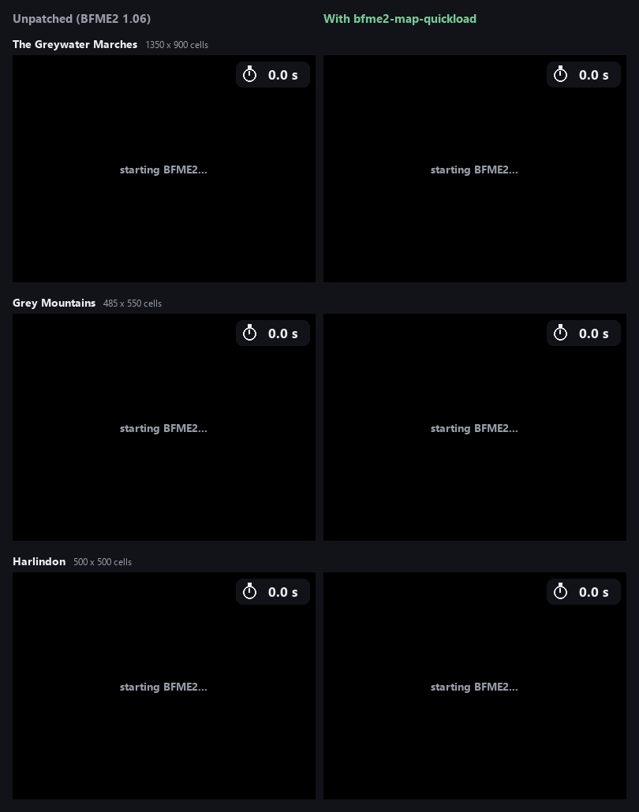

# bfme2-map-quickload

Faster map loading for *The Battle for Middle-earth II* (version 1.06). One
DLL in the game folder; it builds the map's terrain textures on all your
processor cores instead of one, and skips the five seconds the game shows its
title logo after every load.

> Built with help from [OpenBFME2](https://github.com/Open-BFME/Open-BFME-2).



| Map (Medium detail) | Unpatched | Patched | |
| --- | --- | --- | --- |
| The Greywater Marches, 1,350 x 900 cells | 50.5 s | 10.2 s | 5.0x faster |
| Grey Mountains, 485 x 550 cells | 16.9 s | 6.1 s | 2.8x faster |
| Harlindon, 500 x 500 cells | 15.4 s | 5.3 s | 2.9x faster |

Seconds from starting a skirmish to its first frame of play, on a 16-thread
CPU; the animation plays at 2x speed. Bigger maps gain more. These runs leave
out the title logo the game shows after loading, so the patch saves another
five seconds on top of them.

## Install

1. Download `dinput8.dll` from the [latest release](../../releases/latest)
   (or `bin/dinput8.dll` here).
2. Copy it into your BFME2 folder, next to `game.dat`.

That's all: start the game as usual. To uninstall, delete `dinput8.dll` from
the game folder.

- **BFME2 1.06 only.** The DLL checks the game's code before changing
  anything; in any other version, or any other program, it does nothing but
  pass DirectInput through to Windows.
- If your game folder already has a `dinput8.dll` (another mod), don't
  replace it: only one can be loaded.
- The patch changes how fast textures are built, not what the game
  simulates, so it shouldn't affect multiplayer; that is untested.

## What it does

Most of a map's loading time is the game building its terrain textures: for
each one, it composites the terrain on the CPU, then Microsoft's D3DX library
compresses it to DXT1 and builds its mipmaps, one texture after another on the
main thread (about 85% of the load, 1,156 textures on a 480 x 480 map).

The game imports `DirectInput8Create` from `dinput8.dll` and finds this copy
before Windows' own, which it forwards to. In `game.dat` 1.06 the DLL also:

- redirects the game's two import slots for `D3DXLoadSurfaceFromMemory` and
  `D3DXFilterTexture`. Called from the terrain texture builder
  (`TerrainTextureClass::updateFlatDXT1`) while the loading screen shows, each
  texture's pair of calls runs on a worker thread, one fewer than your
  processor count, up to 15: the same two D3DX calls with the same input, into
  a CPU-only staging copy made on a Direct3D device of the DLL's own
  (multithreaded, on a window that is never shown). The finished textures are
  copied into the game's on the main thread, the last ones in the tactical
  view's first update after the loading screen, before the map is drawn.
  Same functions, same input: the terrain comes out the same, and screenshots
  with and without the patch differ only where things move.
- sets the 5000 ms of the title logo's wait after loading
  (`beginTime + 5000 > timeGetTime()`) to 0. The fade-in after it still runs.

Any other caller, texture outside Direct3D's managed pool, or the game after
loading gets the game's own synchronous calls.

## For tools that start the game

`bin/loading.dll` is the launcher build: the same texture work, without the
DirectInput forwarding, the loading-screen detection or the logo change. A
tool that loads it into the game (for example with `LoadLibraryA` on the main
thread at the first engine frame) calls its exported `mwFlush()` (cdecl, no
arguments, returns the number of textures handled) on the main thread when
the map has loaded, before the first frame; from then on the DLL passes
everything through. [bfme2-map-studio](https://github.com/NotNBR/bfme2-map-studio)
does this for its test games, calling it when the new-game pass ends
(`game.dat` RVA 0x248767). Both builds export `mwLoading`, ten counters:
installed, active, workers, deferred, copied, synchronous, failed, peak queue,
last error, flushes.

## Building

```
python build.py --toolchain "C:/.../Microsoft Visual Studio .NET 2003"
```

builds `bin/dinput8.dll` (`loading.cpp` with `MW_STANDALONE`) and
`bin/loading.dll` with Visual C++ .NET 2003 (MSVC 7.1), which links
`msvcr71.dll` as the game does. The game addresses come from
[Open-BFME-2](https://github.com/Open-BFME/Open-BFME-2)'s matched sources.

## Licence

GPL-3.0-only; see [LICENSE](LICENSE). This project is not endorsed by or
affiliated with EA or its licensors; it contains no game files.
